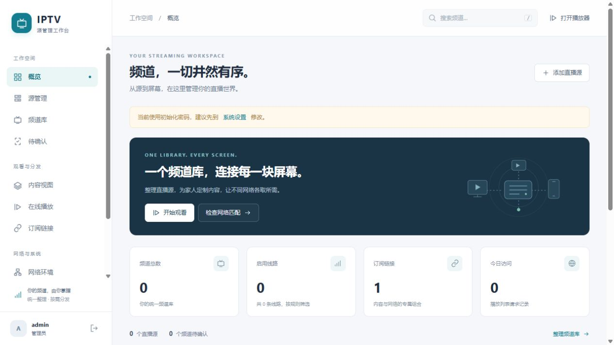

# IPTV Source Cloudflare

[](https://deploy.workers.cloudflare.com/?url=https%3A%2F%2Fgithub.com%2Fliumw%2Fiptv-source-cloudflare)

**[一键部署到 Cloudflare](https://deploy.workers.cloudflare.com/?url=https%3A%2F%2Fgithub.com%2Fliumw%2Fiptv-source-cloudflare)** · [部署与首次管理员初始化](docs/DEPLOY_CLOUDFLARE.md#一键部署到-cloudflare)

基于 **Cloudflare Workers + D1** 的 IPTV 频道管理工具。整理自己的播放列表，再按访问者的运营商、地区和 IPv4/IPv6 条件输出订阅，无需常驻 VPS。

**项目不内置任何直播源、频道、台标库、播放地址或源抓取订阅。** 新部署初始频道库为空；需要自行添加有权使用的播放列表。



## 部署到你自己的 Cloudflare

**快捷方式：** 点击上方按钮，登录自己的 Cloudflare 账号，按向导确认仓库副本、Worker 和 D1 名称即可。部署会自动建表、创建初始账号，并生成独立随机会话密钥，上传为 Cloudflare Secret `SESSION_SECRET`。无需手动填写密钥、安装本机工具、执行命令或导入 SQL。

| 后台入口 | 初始用户名 | 初始密码 |
| --- | --- | --- |
| `https://你的 Worker 域名/_admin` | `admin` | `admin123` |

**首次登录必须设置至少 12 位的新密码**，之后才能使用后台和管理 API。后续重新部署保留已有账号、密码、设置及订阅 token；只有没有管理员的数据库才会自动初始化。初始频道库为空。

会话密钥保存在 Cloudflare 的 Secret 存储中；已有密钥会保留，后续部署不会重新生成。临时密钥文件不会提交 GitHub，也不会进入网页静态资源或 D1。若无法查询现有密钥，部署会停止以避免意外覆盖。

**已有 Fork：** 按[一键部署说明](docs/DEPLOY_CLOUDFLARE.md#一键部署到-cloudflare)将部署链接中的仓库地址换成自己的 Fork；若希望直接连接现有 Fork 并复用手动创建的 D1，使用教程的 [Git 自动构建步骤](docs/DEPLOY_CLOUDFLARE.md#6b-可选连接-fork使用-cloudflare-自动构建)。首页按钮默认以本仓库为模板，不会自动识别 Fork 的所有者。

**手动建立 D1：** 原有部署方式继续可用：

1. **Fork** 本仓库；Star / Follow 不会自动部署。
2. 在自己的 Cloudflare 控制台**手动创建 D1 数据库**。
3. 本地运行 `pnpm init:admin`，生成自己的初始管理员、随机密码、会话密钥和导入 SQL。
4. 在自己的 D1 中建立表结构，导入生成的管理员 SQL。
5. 部署 Worker，登录后台，再添加自己的源。

**完整操作步骤：[Cloudflare 部署教程](docs/DEPLOY_CLOUDFLARE.md)**。包含 D1 控制台建库、管理员 SQL 导入、命令行部署、连接 Fork 自动构建、密钥配置及常见故障排查。

已完成真实云端部署、D1 自动建表、独立管理员初始化和公网登录验证，详见[端到端实测记录](docs/DEPLOY_CLOUDFLARE.md#端到端实测2026-10-21)。

一键部署只需要 GitHub 和 Cloudflare 账号；本地开发或手动部署需要 Node.js 24、pnpm 11 和 Git。项目代码以 MIT 协议开放；第三方播放器的许可证见 [THIRD_PARTY_NOTICES.md](THIRD_PARTY_NOTICES.md)。

## 功能

- URL、上传文件、粘贴文本导入 M3U / TXT；支持 UTF-8 和 GB18030。
- 频道归一、待确认审核、频道合并、别名、默认线路、优先级和手工排除。
- 大号数字台号、线路台标、搜索和适配手机的后台播放器。
- 手动创建频道，可同时填写播放地址，也可先建空频道再添加线路，无需导入源。
- 单个或批量物理删除频道，同时清理其线路、别名和内容视图关联；订阅缓存立即失效。
- 内容视图、指定频道、分组规则及订阅 token。
- 默认自动识别访问者：Cloudflare 原生 IP / ASN / 地区；按实际访问协议保守筛选。
- 可选固定网络环境、网段绑定；订阅默认不允许参数覆盖识别结果。
- 白名单、访问日志、ETag/304 和按网络条件隔离的缓存。
- 模板在构建时预编译，运行时无需 Python、磁盘文件或 eval。

## 快速本地体验

```sh
git clone https://github.com/YOUR-GITHUB-USERNAME/iptv-source-cloudflare.git
cd iptv-source-cloudflare
pnpm install --frozen-lockfile
pnpm init:admin
pnpm db:local
pnpm db:init:local
pnpm dev
```

用 `private/bootstrap.credentials.txt` 中的账号密码登录 <http://127.0.0.1:8787/_admin>。这些命令仅初始化本机 D1，不会创建云端资源。云端部署请先按教程填写你自己的 D1 ID。

初始化只写入：一个管理员、基础设置、一个空内容视图，以及一个带随机 token 的自动识别订阅 `/live`。源、频道、线路和固定网络环境均为 **0**；测试目录中的 `example.com` 地址仅是测试数据，不会写入用户数据库。

生成文件已被 `.gitignore` 排除：

| 文件 | 用途 |
| --- | --- |
| `private/bootstrap.sql` | 将自己的初始管理员导入新 D1；含密码哈希和订阅 token |
| `private/bootstrap.credentials.txt` | 查看独立初始账号和密码 |
| `.dev.vars` | 随机 `SESSION_SECRET`；本地开发和本机部署读取 |

以上本地/手动初始化方式使用独立随机密码，和一键部署的 `admin / admin123` 不同。初始化脚本会拒绝覆盖已有初始化文件，SQL 也不会覆盖已有管理员；后续升级不要重复手动导入初始化 SQL。

## 常用命令

```sh
pnpm check          # 构建和 TypeScript 检查
pnpm test           # 包含空库初始化、首次登录及部署流程测试
pnpm format:check
pnpm deploy:check   # 只检查部署打包，不上传
pnpm run deploy     # 本机上传 .dev.vars；Workers Builds 自动建表、初始化空库和缺失密钥，再发布
```

## 网络识别与运行范围

Cloudflare 识别访问出口；通过代理访问时识别代理出口。本次 IPv4 请求不能证明访问者没有 IPv6，本次 IPv6 请求也不能证明访问者支持 IPv4。因此自动模式按本次实际连接协议筛选，IPTV 专网权限需显式配置。

筛选依赖线路的网络、运营商和地区标记；它不保证每条源地址始终有效。Workers 不能接入家中 IPTV 组播专网。后台浏览器播放还受源站 CORS、HTTPS 混合内容和授权限制。

视频代理默认关闭，客户端直接连接源站。免费计划有请求量、CPU 和 D1 额度，大源导入或高频访问可能触及限制。详情见部署教程。

## 项目结构

```text
src/               Workers 后端
ui/templates/      后台模板
ui/static/         样式、交互和 HLS 播放器
migrations/        仅表结构，不含管理员、直播源或频道数据
scripts/           构建、独立管理员初始化和部署工具
test/              隔离的测试夹具
docs/              完整部署说明
```

公开问题请发 [Issue](https://github.com/liumw/iptv-source-cloudflare/issues)。不要附上 `.dev.vars`、初始化 SQL、数据库备份、会话 cookie 或带令牌的完整订阅地址。
